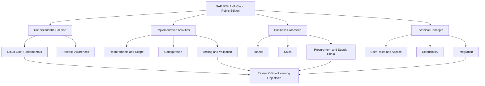
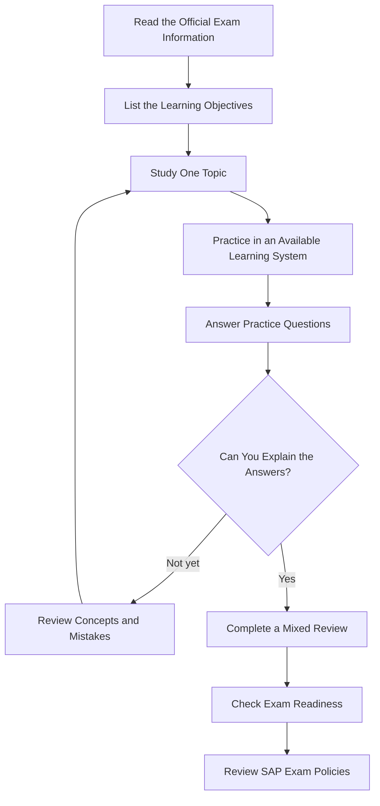
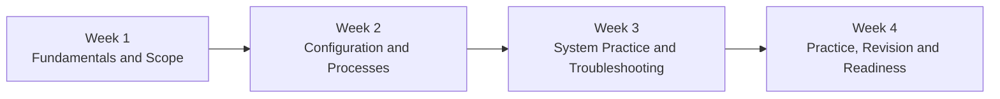

 SAP C_S4CPB_2602 Study Guide — SAP S/4HANA Cloud Public Edition

Prepare for the SAP C_S4CPB_2602 certification with a structured study plan, implementation concepts, hands-on practice ideas, and exam-readiness guidance.

This repository is designed for learners who want to understand SAP S/4HANA Cloud Public Edition implementation concepts and organize their certification preparation effectively.

Explore exam preparation resources at CertsGate:
https://certsgate.com/exams/sap/c_s4cpb

 Table of Contents

- [About the Certification](#about-the-certification)
- [Who Should Use This Guide?](#who-should-use-this-guide)
- [What to Study](#what-to-study)
- [Implementation Learning Map](#implementation-learning-map)
- [Recommended Study Workflow](#recommended-study-workflow)
- [Four-Week Study Plan](#four-week-study-plan)
- [Practice Questions and Review](#practice-questions-and-review)
- [Hands-On Preparation Checklist](#hands-on-preparation-checklist)
- [Common Preparation Mistakes](#common-preparation-mistakes)
- [Frequently Asked Questions](#frequently-asked-questions)
- [Official SAP Resources](#official-sap-resources)
- [CertsGate Exam Preparation Resources](#certsgate-exam-preparation-resources)
- [Disclaimer](#disclaimer)

---

 About the Certification

Then SAP Certified – Implementation Consultant – SAP S/4HANA Cloud Public Edition certification focuses on the knowledge and skills required to participate in implementation projects for SAP's cloud ERP solution.
 
The C_S4CPB_2602 designation relates to the 2602 release. SAP announced that its SAP S/4HANA Cloud Public Edition certification learning content and assessments were updated to reflect the 2602 release.

Official certification information:
https://learning.sap.com/certifications/sap-certified-associate-implementation-consultant-sap-s-4hana-cloud-public-edition

Exam preparation resources:
https://certsgate.com/exams/sap/c_s4cpb

 Certification at a Glance

| Detail | Information |
|---|---|
| Certification provider | SAP |
| Certification area | SAP S/4HANA Cloud Public Edition |
| Exam code | C_S4CPB_2602 |
| Main focus | Implementation consulting |
| Preparation approach | Official learning content, system practice, and self-assessment |
| Recommended starting point | SAP's official certification learning journey |

Always check SAP's official certification page for the latest assessment format, duration, eligibility requirements, and policies before scheduling your exam.

---

 Who Should Use This Guide?

This repository may be useful for:

- Aspiring SAP implementation consultants
- SAP functional consultants expanding their cloud ERP knowledge
- ERP professionals moving toward SAP S/4HANA Cloud Public Edition
- Project team members involved in implementation activities
- Students preparing for SAP certification
- Professionals who want a structured revision plan

Some SAP experience can make the implementation concepts easier to understand, but learners should assess their own background and follow the prerequisites or recommendations listed by SAP.

---

 What to Study

Use the following areas as a **suggested revision framework**. Confirm the exact examinable objectives in SAP's current learning journey rather than treating this list as a complete official syllabus.

 1. SAP S/4HANA Cloud Public Edition Fundamentals

Understand the cloud ERP environment, its purpose, and how implementation teams work with the solution.

Suggested review topics:

- Core cloud ERP concepts
- Standard business processes
- Implementation project roles
- Cloud solution adoption
- Release updates and learning resources

 2. Implementation and Configuration

Build a clear understanding of how implementation teams prepare and configure a solution to meet business requirements.

Suggested review topics:

- Business requirements and scope
- Organizational structure concepts
- Configuration activities
- Business process validation
- Testing and issue resolution

 3. Business Processes

Study how business activities connect across an organization. Depending on the official learning objectives, review relevant processes involving areas such as finance, sales, sourcing and procurement, and supply chain.

Focus on understanding the relationship between process steps, business data, and system outcomes.

 4. System Setup and User Access

Review the concepts associated with preparing a cloud system for business users.

Suggested review topics:

- Initial system setup
- Business users and roles
- Access restrictions and authorizations
- Application navigation
- Configuration validation

5. Extensibility and Integration

Understand how cloud solutions can be adapted and connected while maintaining a controlled implementation approach.

Suggested review topics:

- Standard functionality versus extensions
- Key-user extensibility concepts
- Custom fields and user-interface adaptations
- Integration fundamentals
- APIs and connected systems, where included in the official objectives

 6. Testing and Troubleshooting

Practice explaining how you would validate a business process and investigate unexpected results.

Suggested review topics:

- Testing business scenarios
- Identifying configuration issues
- Checking user access
- Reviewing process results
- Documenting and resolving problems

---

## Implementation Learning Map

The diagram below is a conceptual study map, not an official SAP exam blueprint.

Use this map to organize your revision, then prioritize topics according to SAP's current official learning content.

---

Recommended Study Workflow

A good preparation routine should include learning, practical application, and review—not just memorizing definitions.

 Suggested Daily Routine

1. Choose one topic from the official learning objectives.
2. Read the relevant SAP learning material.
3. Write short notes in your own words.
4. Apply the concept in a learning system when access is available.
5. Answer relevant practice questions.
6. Record mistakes and revisit weak areas.

---

Four-Week Study Plan

This is an example schedule for organizing preparation. It is not an official SAP timetable; adjust it to your background, available study time, and the current learning objectives.

| Week | Main goal | Suggested activities |
|---|---|---|
| Week 1 | Build the foundation | Read official learning content and organize the exam objectives |
| Week 2 | Understand implementation concepts | Study configuration and relevant business processes |
| Week 3 | Apply what you learn | Practice scenarios, system activities, and troubleshooting |
| Week 4 | Review weak areas | Complete practice sets, revisit mistakes, and assess readiness |

If you already have SAP implementation experience, you may move more quickly through familiar material. Spend more time on unfamiliar topics instead.

---

 Practice Questions and Review

Practice questions can help identify gaps in understanding and show which concepts need more revision.

For each practice session:

- Answer questions before checking the explanations.
- Understand why the correct answer fits the scenario.
- Review why other options are less appropriate.
- Keep a list of concepts you repeatedly miss.
- Revisit the related official learning material.
- Repeat the questions later to check whether your understanding has improved.

Explore C_S4CPB preparation resources at CertsGate:**

https://certsgate.com/exams/sap/c_s4cpb

Use practice material as a learning aid, not as a substitute for the official syllabus, hands-on experience, or SAP's own preparation resources.

 Example Learning Question

Question: During an implementation project, a business user cannot access an application needed for their assigned tasks. What should you investigate first?

A. Whether the user has the appropriate business role and authorizations  
B. Whether the entire ERP system should be replaced  
C. Whether all integration interfaces should be disabled  
D. Whether unrelated business processes should be reconfigured  

Best answer: A

Explanation: Checking the user's assigned role and relevant authorizations is a sensible first step when access to an application is missing. The exact resolution depends on the system configuration and the circumstances.

*This is an illustrative learning question, not a verified question from the SAP certification exam.*

---

 Hands-On Preparation Checklist

Use this checklist to track your progress.

- [ ] Read the current SAP certification page.
- [ ] Review the official learning journey.
- [ ] Identify the topics that need the most attention.
- [ ] Study SAP S/4HANA Cloud Public Edition fundamentals.
- [ ] Review relevant implementation and configuration concepts.
- [ ] Understand the business processes covered by the official objectives.
- [ ] Review user roles, access, and system setup.
- [ ] Study relevant extensibility and integration concepts.
- [ ] Practice scenarios in an available learning environment.
- [ ] Complete practice questions and review incorrect answers.
- [ ] Revisit weak areas and repeat your self-assessment.
- [ ] Confirm the current exam format and policies with SAP.

---

 Common Preparation Mistakes

 Studying Without Checking the Official Objectives

A generic study guide may not cover every current exam requirement. Use SAP's learning journey to determine what to study.

 Memorizing Answers Without Understanding the Process

Remembering an answer is less useful than understanding the business scenario, the underlying configuration, and the reason a solution works.

 Ignoring Hands-On Practice

Where learning-system access is available, use it to reinforce concepts and understand how implementation activities work in practice.

 Skipping Mistake Review

Repeated errors can reveal gaps in understanding. Record them and revisit the relevant learning material before attempting another practice set.

 Relying on Outdated Content

The C_S4CPB_2602 designation is associated with the 2602 release. Check that your learning materials match the current release and official assessment objectives.

---

Frequently Asked Questions

 What is the C_S4CPB_2602 certification?

It refers to SAP's implementation consultant certification for SAP S/4HANA Cloud Public Edition, aligned with the 2602 release.

 Where can I find official exam information?

Start with the SAP certification page:

https://learning.sap.com/certifications/sap-certified-associate-implementation-consultant-sap-s-4hana-cloud-public-edition

 How should I prepare for the exam?

Review SAP's official learning objectives, study each topic, practice relevant implementation scenarios, answer practice questions, and revisit your mistakes.

 Are practice questions enough to prepare?

Practice questions are useful for revision and self-assessment, but they should be combined with official learning material and practical understanding.

Where can I find additional preparation material?

Visit the CertsGate page for this exam:

https://certsgate.com/exams/sap/c_s4cpb

 Does this repository represent official SAP content?

No. It is an independent study guide intended to help organize preparation. SAP remains the authoritative source for certification requirements and exam policies.

---

 Official SAP Resources

Use official SAP resources to confirm current requirements and deepen your understanding.

- SAP certification page 
  https://learning.sap.com/certifications/sap-certified-associate-implementation-consultant-sap-s-4hana-cloud-public-edition

-SAP S/4HANA Cloud Public Edition learning content:**  
  https://learning.sap.com/

- SAP certification and learning information:**  
  https://training.sap.com/

Check the relevant certification page for the latest exam details before booking your assessment.

---

CertsGate Exam Preparation Resources

CertsGate provides an additional destination for learners exploring IT certification preparation material and practice resources.

For SAP C_S4CPB_2602 preparation, visit:

https://certsgate.com/exams/sap/c_s4cpb

Use the page alongside official SAP resources to organize your study, review key concepts, and identify areas for further practice.

